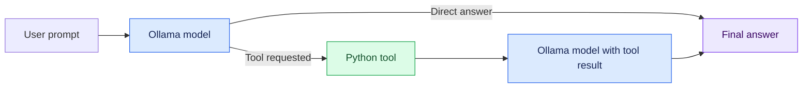

# 🔍 Project 6 · LangSmith Agent Observability

A Windows PowerShell walkthrough for tracing a local LangChain agent running `qwen3.5:4b` through Ollama. The agent can answer directly or call one of two Python tools, `current_time` and `word_count`. LangSmith records the execution path and timing when cloud tracing is enabled.

## 🟦 Execution paths



## 🟩 Run locally

Use the project folder containing `trace_agent.py`. Start Ollama before running the agent.

```powershell
python -m venv .venv
.\.venv\Scripts\Activate.ps1
python -m pip install langchain langchain-ollama langsmith
ollama pull qwen3.5:4b

$env:LANGSMITH_TRACING = "false"
python .\trace_agent.py
```

At `You:`, enter either prompt from the verification table. Type `exit` to return to PowerShell.

## 🟪 Enable LangSmith Cloud tracing

In the LangSmith workspace, register an agent with ID `langsmith-agent-observability` and use its **Local** environment. Generate a LangSmith API key for that workspace and use the endpoint or workspace ID from the setup screen if specified. In the same PowerShell session, run:

```powershell
Remove-Item Env:LANGSMITH_PROJECT, Env:LANGCHAIN_PROJECT, Env:LANGCHAIN_SESSION -ErrorAction SilentlyContinue
$env:LANGSMITH_AGENT_ID = "langsmith-agent-observability"
$env:LANGSMITH_AGENT_ENVIRONMENT = "local"
$env:LANGSMITH_TRACING = "true"

$langsmithKey = Read-Host "Paste your LangSmith API key" -AsSecureString
$env:LANGSMITH_API_KEY = [pscredential]::new("langsmith", $langsmithKey).GetNetworkCredential().Password
Remove-Variable langsmithKey

python .\trace_agent.py
```

Paste the key at the masked prompt. Use sample inputs because cloud tracing sends request and response data to LangSmith. Ollama still runs inference locally. The tutorial was run on the Developer plan with Base retention. See [LangSmith pricing](https://www.langchain.com/pricing) and [LangSmith billing](https://docs.langchain.com/langsmith/billing).

## ✅ Verified runs

Observed in LangSmith on November 12, 2026 (Pacific time).

| Prompt | Trace path | Result | Total latency |
|---|---|---|---:|
| What is the capital of France? | One `ChatOllama` call, zero tool runs | Paris | 58.08 s |
| Count the words in "Cedar needs a CI smoke test." | `ChatOllama` → `word_count` → `ChatOllama` | Tool returned `6` | 21.63 s |

- **Paris:** LangSmith reported 57.99 s for the model call and 57.04 s to first token. It recorded 354 input tokens and 8 output tokens.
- **Cedar:** The two model calls took 19.00 s and 2.52 s. The tool duration displayed as 0.00 s at the UI's precision.

In **Local → Tracing**, open each top-level `LangGraph` run and expand the child runs. Select `word_count` to inspect the tool input and output. Select `ChatOllama` to inspect model timing. These timings represent one captured trace per path. A benchmark would require repeated runs under comparable conditions.

## 📚 References

- [freeCodeCamp tutorial by Darsh Shah](https://www.freecodecamp.org/news/how-to-trace-and-monitor-ai-agents-with-langsmith/)
- [LangSmith tracing for LangChain agents](https://docs.langchain.com/langsmith/trace-with-langchain)
