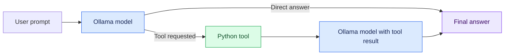

# 🔍 Project 6 · LangSmith Agent Observability

A Windows PowerShell walkthrough for tracing a local LangChain agent running `qwen3.5:4b` through Ollama. LangSmith records the execution path and timing when cloud tracing is enabled.

## 🟦 Base tutorial

The baseline follows Darsh Shah’s [How to Trace and Monitor AI Agents with LangSmith](https://www.freecodecamp.org/news/how-to-trace-and-monitor-ai-agents-with-langsmith/). It runs a local Ollama agent with `current_time` and `word_count`, then uses LangSmith to inspect the model and tool calls. The verified baseline traces below cover a direct answer (Paris) and a tool call (Cedar, 6 words).

## 🧩 Extensions added in Project 6

| Extension | What we added or measured | Verified result |
|---|---|---|
| 🏷️ **1. Trace names, tags, and metadata** | Named the run `local-ollama-agent`, added `project-6` and `ollama` tags, and attached model and app version metadata. The CI pilot also labels the evidence condition. | LangSmith showed the run name and both tags on model runs. |
| ⏱️ **2. Latency comparison** | Compared total request latency and time to first token on the first model call across three tagged traces per prompt. | Median total latency was **5.35 s** for Paris and **11.00 s** for Cedar. Median time to first token was **4.66 s** and **8.53 s**, respectively. |
| 🧪 **3. Controlled tool failure and recovery** | Added `fail_demo`, which raises `DemoToolError`. The CLI catches it and continues accepting prompts. | LangSmith showed the error on the tool and top-level trace. The next Paris prompt succeeded in the same CLI session. |
| 🔎 **4. CI diagnosis with and without evidence** | Added `lookup_ci_log` and ran the same MAPLE-207 question with the synthetic log available and withheld. | The agent quoted the signing error when available and reported insufficient evidence when withheld. Both traces completed successfully. |

The latency comparison includes setup runs and describes these six traces. The CI comparison uses one synthetic build and one run per condition.

## 🟦 Execution paths



## 🟩 Run locally

Use the project folder containing `trace_agent.py`. Start Ollama before running the agent.

```powershell
python -m venv .venv
.\.venv\Scripts\Activate.ps1
python -m pip install langchain langchain-ollama langsmith
ollama pull qwen3.5:4b

$env:LANGSMITH_TRACING = "false"
python .\trace_agent.py
```

At `You:`, enter either prompt from the verification table. Type `exit` to return to PowerShell.

## 🟪 Enable LangSmith Cloud tracing

In the LangSmith workspace, register an agent with ID `langsmith-agent-observability` and use its **Local** environment. Generate a LangSmith API key for that workspace and use the endpoint or workspace ID from the setup screen if specified. In the same PowerShell session, run:

```powershell
Remove-Item Env:LANGSMITH_PROJECT, Env:LANGCHAIN_PROJECT, Env:LANGCHAIN_SESSION -ErrorAction SilentlyContinue
$env:LANGSMITH_AGENT_ID = "langsmith-agent-observability"
$env:LANGSMITH_AGENT_ENVIRONMENT = "local"
$env:LANGSMITH_TRACING = "true"

$langsmithKey = Read-Host "Paste your LangSmith API key" -AsSecureString
$env:LANGSMITH_API_KEY = [pscredential]::new("langsmith", $langsmithKey).GetNetworkCredential().Password
Remove-Variable langsmithKey

python .\trace_agent.py
```

Paste the key at the masked prompt. Use sample inputs because cloud tracing sends request and response data to LangSmith. Ollama still runs inference locally. The tutorial was run on the Developer plan with Base retention. See [LangSmith pricing](https://www.langchain.com/pricing) and [LangSmith billing](https://docs.langchain.com/langsmith/billing).

## ✅ Verified runs

Observed in LangSmith on November 12, 2026 (Pacific time).

| Prompt | Trace path | Result | Total latency |
|---|---|---|---:|
| What is the capital of France? | One `ChatOllama` call, zero tool runs | Paris | 58.08 s |
| Count the words in "Cedar needs a CI smoke test." | `ChatOllama` → `word_count` → `ChatOllama` | Tool returned `6` | 21.63 s |

- **Paris:** LangSmith reported 57.99 s for the model call and 57.04 s to first token. It recorded 354 input tokens and 8 output tokens.
- **Cedar:** The two model calls took 19.00 s and 2.52 s. The tool duration displayed as 0.00 s at the UI's precision.

In **Local → Tracing**, open each top-level `LangGraph` run and expand the child runs. Select `word_count` to inspect the tool input and output. Select `ChatOllama` to inspect model timing. These timings represent one captured trace per path. A benchmark would require repeated runs under comparable conditions.

## 🟪 CI diagnosis with and without evidence

Both runs asked: `Why did build MAPLE-207 fail?`

| Condition | Lookup output | Verified agent behavior |
|---|---|---|
| Evidence available | `ERROR [signing] Signing certificate expired.` | Identified the expired certificate and quoted the exact log line. |
| Evidence withheld | `No CI log available for MAPLE-207.` | Reported insufficient evidence and left the cause undetermined. |

Both requests completed successfully. Each condition was tested once with
synthetic evidence. Inspect the `lookup_ci_log` child run and the final AI
message in LangSmith to verify the behavior.

To reproduce the pilot in PowerShell, set `$env:BRI_HIDE_CI_LOG = "0"` for the available condition or `"1"` for the withheld condition before starting `python .\trace_agent.py`. Ask the same question in each run. Afterward, use `Remove-Item Env:BRI_HIDE_CI_LOG` to restore the default.

## 📚 References

- [freeCodeCamp tutorial by Darsh Shah](https://www.freecodecamp.org/news/how-to-trace-and-monitor-ai-agents-with-langsmith/)
- [LangSmith tracing for LangChain agents](https://docs.langchain.com/langsmith/trace-with-langchain)
